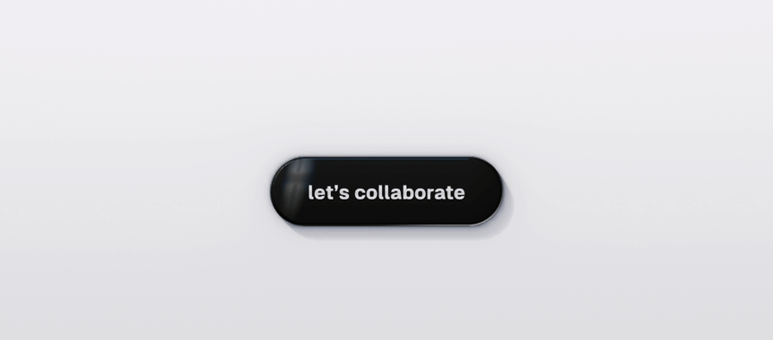

# Effects Lab · 动效库

收录可独立运行的交互动效和视觉实验。每个特效放在自己的目录里，可以单独下载、运行和修改。

## 特效目录

### Venom Button · 毒液按钮

黑胶缠绕光标，拉断时甩出墨珠，点击泛起波纹。

[查看源码和使用说明](effects/venom-button/) · WebGL 2 · 单文件 HTML

## 如何体验

下载或克隆仓库，进入对应的 `effects/<name>/` 目录。单文件特效直接打开其中的 `index.html`，有额外依赖的项目以目录里的 `README.md` 为准。

## 新增特效

- 在 `effects/` 下用小写短横线命名，每个特效独立存放。
- 各目录包含可运行入口和使用说明。新增作品时，在首页特效目录添加条目。有动图的作品可将 `preview.gif` 放在对应目录，用相对路径嵌入首页。
- 改编作品注明原作者、来源和改动。许可证及第三方素材许可放在特效目录内，不以仓库首页替代。
- 这里只收录可公开的源码和已获授权的素材，不放凭据、第三方原片或内部工作文件。
